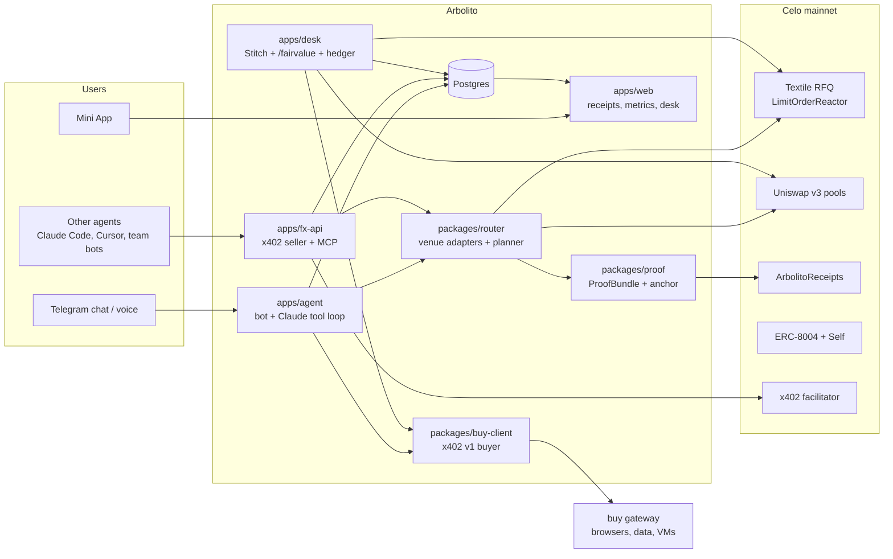

# 03: Architecture

## System overview


## Monorepo layout
```
arbolito/
  apps/
    agent/        Telegram bot (grammY), Claude tool loop, STT, rule scheduler
    fx-api/       Hono x402 v2 seller (quote/convert/send), bazaar metadata, /.well-known agent card
    mcp/          arbolito-mcp (stdio + streamable HTTP) wrapping fx-api tools
    desk/         /fairvalue feed, risk officer, hedger, P&L ledger, VM provisioner, stitch.toml templates
    web/          Next.js: Mini App, /r/:id receipts, /metrics, /desk
  packages/
    config/       chain, tokens, pools, contracts (sourced from docs/04-reference.md), env schema (zod)
    chain/        viem clients, attribution suffix, fee-currency helpers, tx sender with caps
    router/       VenueAdapter interface, textile/, uniswap/, planner, slippage guards
    proof/        ProofBundle schema, canonical JSON, keccak, anchor, verifier
    buy-client/   x402 v1 buyer, quote-then-pay, idempotency, poll-URL redaction
    x402/         shared v1/v2 helpers, facilitator client, permit2 asset support
    db/           Drizzle schema + migrations
    llm/          Claude client, tool definitions, prompts (es/pt/en), risk-officer prompt
  contracts/      Foundry: ArbolitoReceipts.sol (+ RouteExecutor.sol if needed)
  docs/
```

## Core types (sketch)
```ts
type Venue = "textile_rfq" | "uniswap_v3" | "textile_limit";
interface Quote {
  venue: Venue; tokenIn: Address; tokenOut: Address;
  amountIn: bigint; amountOut: bigint;        // atomic units
  expiresAt?: number; blockNumber: bigint;
  firm: boolean; raw: unknown;                // full venue payload (maker sig etc.)
}
interface Leg { quote: Quote; minOut: bigint }
interface Route { id: string; legs: Leg[]; amountIn: bigint; expectedOut: bigint; taker: Address }
interface VenueAdapter {
  quote(p: { tokenIn: Address; tokenOut: Address; amountIn: bigint; taker: Address }): Promise<Quote | null>;
  buildExecution(leg: Leg, taker: Address): Promise<Call[]>;   // calls for a batch / userOp
}
interface ProofBundle {
  v: 1; routeId: string; createdAt: string; chainId: 42220;
  request: { tokenIn; tokenOut; amountIn; taker };
  quotesConsidered: Quote[]; chosen: Route;
  references: { name: "official"|"mep"|"ccl"|"crypto"|"textile_mid"|"uniswap_mid"; rate: string; source: string; at: string }[];
  competitor?: { provider: string; rate: string; screenshotSha256: string; buySettlementTx: string };
  execution: { txHash: string; blockNumber: string; amountOut: string };
}
// bundleHash = keccak256(canonicalJson(bundle)) → ArbolitoReceipts.emitReceipt(bundleHash, routeId)
```

## Key flows

### Cross-border send (BRL → ARS)
```mermaid
sequenceDiagram
  participant U as User (Telegram)
  participant A as Agent
  participant R as Router
  participant T as Textile RFQ
  participant V as Uniswap v3
  participant C as Celo (smart account)
  participant P as Proof
  U->>A: "manda 200 reais pra Lucía"
  A->>R: plan(wBRL→wARS, 200e18, taker)
  par leg 1
    R->>T: firm quote wBRL→USDT
    R->>V: QuoterV2 wBRL→USDT
  and refs
    R->>R: Textile tickers, dolar refs
  end
  R->>T: firm quote USDT→wARS (exact USDT from leg 1)
  R->>V: QuoterV2 USDT→wARS
  R-->>A: best route + alternatives
  A-->>U: route card [Confirmar]
  U->>A: Confirmar
  A->>C: batch(permit/approve, leg1, leg2) + attribution suffix
  C-->>A: tx receipt
  A->>P: build bundle, hash, emitReceipt
  A-->>U: done + /r/:id; notify Lucía (es)
```

### buy purchase (quote, then pay)
1. `POST` to the endpoint unpaid and get a 402 challenge (v1).
2. Validate it: it must be a real 402 with an x402 body. A 200 or HTML means error.
3. Check the price against the per-capability budget, and choose **USA₮**.
4. Sign and pay with an identical request plus the `X-PAYMENT` header.
5. Store the settlement reference, response and purpose in `buy_purchases`. Redact poll URLs.
6. On 5xx after paying: **do not retry**. Mark the purchase `uncertain`, check settlement onchain, and reconcile.

### x402 FX API (selling)
- Hono app with `paymentMiddleware` (v2) and `HTTPFacilitatorClient` (`https://api.x402.celo.org`, X-API-Key).
- Each route accepts these options:

| Option | Assets | Method |
|---|---|---|
| 1 | USA₮ (default), USDC, USDT | eip3009 |
| 2 | wARS, wBRL, wCOP | permit2 |

- `/v1/quote` costs a flat micro-fee. `/v1/convert` and `/v1/send` charge a fee in bps (paid as x402) plus the conversion itself.
- If the caller holds wFIAT, the conversion is executed from the caller's own funds via signed permits. Decide this in the spike.
- Optional `SelfAgentVerifier` gate: amounts above $X require a human-backed, OFAC-clear caller agent.

### Desk loop
1. `/fairvalue` runs every few seconds:
   - mid = weighted(Textile ticker mid, Uniswap TWAP, CCL/crypto ref)
   - plus an inventory skew
   - plus a regime adjustment
2. The risk officer (LLM) runs every 15 minutes or on events:
   - reads buy X/Reddit signals and the calendar (INDEC, BCRA, COPOM dates)
   - outputs `{regime, spreadBps, maxSize}`
   - Stitch restarts when `stitch.toml` changes.
3. Stitch polls `/fairvalue` and answers Textile RFQs with signed firm quotes.
4. A webhook or chain watcher records fills to `desk_fills`. The P&L is marked against mid.
5. The hedger sends inventory drift beyond a threshold to Uniswap (wARS/USDT, wBRL/USDT).
6. The provisioner (P1) buys a buy VM (e2-small, USA₮) at T−2h before expiry, boots Stitch, stops the old VM, records the cost in `desk_costs`. Fallback: a VPS.

## Data model (Postgres / Drizzle)
`users`, `contacts`, `session_permissions`, `quotes`, `routes`, `executions`, `receipts`, `rules`, `rule_runs`, `buy_purchases`, `api_sales`, `desk_quotes`, `desk_fills`, `desk_costs`, `metrics_snapshots`.

Every money row stores `token`, `amount_atomic` (numeric), `usd_at_time`, `tx_hash`, `attribution_code`.

## Wallet and security model
- **Users:** smart account (thirdweb on Celo), owned by the user's in-app wallet (Telegram/Google login in the Mini App).
  - Arbolito holds a **session key** scoped to: per-action cap, daily cap, expiry, and target allowlist (Textile reactor, Permit2, Uniswap router, ArbolitoReceipts, saved contacts).
  - **Spike (Day 2–3):** confirm Textile settlement and Permit2 work with a contract taker (EIP-1271). If not, use EIP-7702-delegated EOAs (ECDSA stays valid) or per-user EOAs with server-held session limits.
- **Ops wallet:** deploys contracts and holds the USA₮ treasury. It is never used by the bot directly.
- **Desk wallet:** a dedicated hot wallet. Inventory is capped in code (`DESK_MAX_INVENTORY_USD`), and only the desk process holds the key. On a buy VM, the key is injected at boot and the VM is short-lived.
- **buy payer wallet:** dedicated and capped; per-capability daily budgets.
- **Threats and mitigations:**

| Threat | Mitigation |
|---|---|
| Prompt injection via scraped pages or chat | Tools never move funds without the confirm/rule path; the LLM can't change recipients or caps |
| Stale quotes | Expiry is enforced; minOut on every leg |
| Double payment | Idempotency keys; no blind retries |
| Key leakage | Env only; redacted logs |
| Desk gap risk | Inventory caps; regime kill-switch (stop quoting when stressed) |

## Deployment
- `apps/agent`, `apps/fx-api` and `apps/mcp` (HTTP) on Railway, Fly or a VPS (always-on). `apps/web` on Vercel. Postgres on Neon.
- `apps/desk` on a buy VM (P1), falling back to a VPS.
- Chainstack RPC (hackathon perk), with forno as fallback.

## Testing strategy
- **Unit:** planner math, canonical JSON/hash, x402 challenge parsing (v1/v2, non-402), caps.
- **Fork tests** (`anvil --fork-url https://forno.celo.org`): Uniswap legs, Permit2 flows, Textile firm-quote execution against forked state, receipts emission.
- **Mainnet smoke:** ≤ $2 per action, behind an explicit `--live` flag and a user go-ahead.

## Spikes to resolve early (with decision rules)
| Spike | By | If it fails |
|---|---|---|
| Textile v2 taker flow (who submits the tx? Permit2 witness?) per `openapi-v2.json` | Day 2 | Uniswap-only routing; escalate to organizers |
| Smart-account taker compatibility with Textile/Permit2 | Day 3 | 7702 EOAs or EOAs with server-side limits |
| Stitch headless on Linux + custom feed | Day 3 | Our own minimal filler over the v2 API webhooks |
| buy browser session API (how to drive it: CDP URL? scripted steps?) | Day 5 | Reference rates only; buy for social data |
| x402 permit2 assets (wARS/wBRL/wCOP) seller config | Day 6 | Accept USA₮/USDC/USDT only; convert after |
