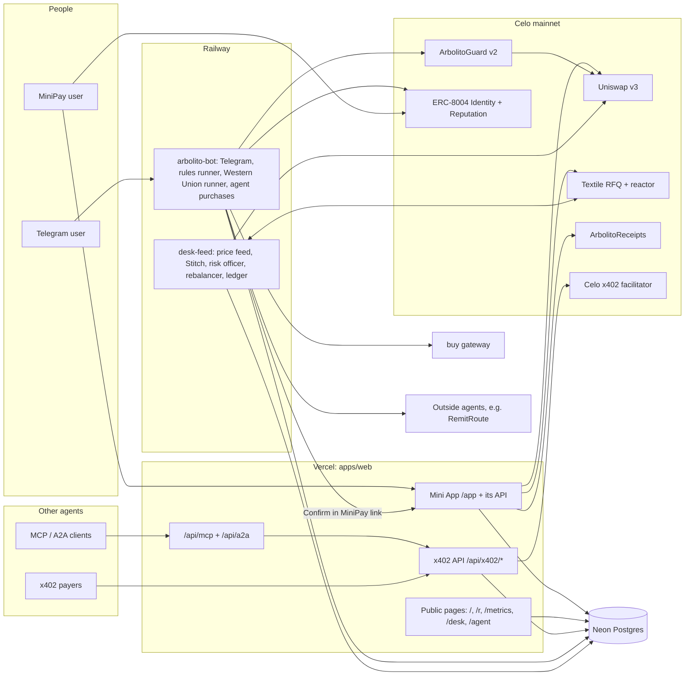
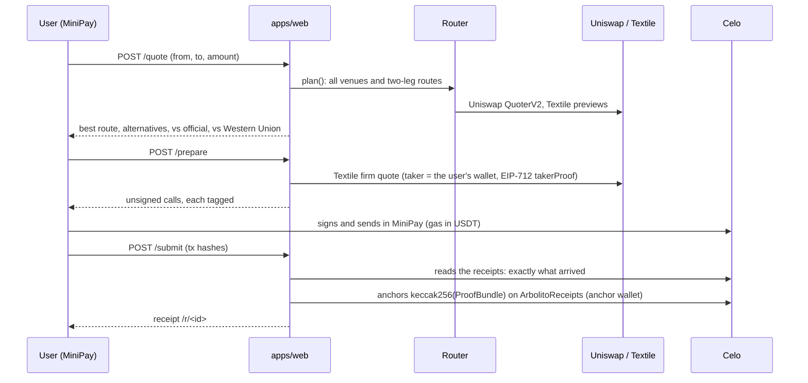
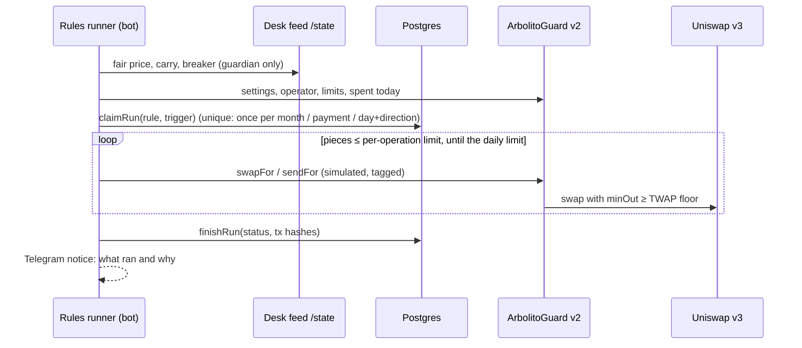
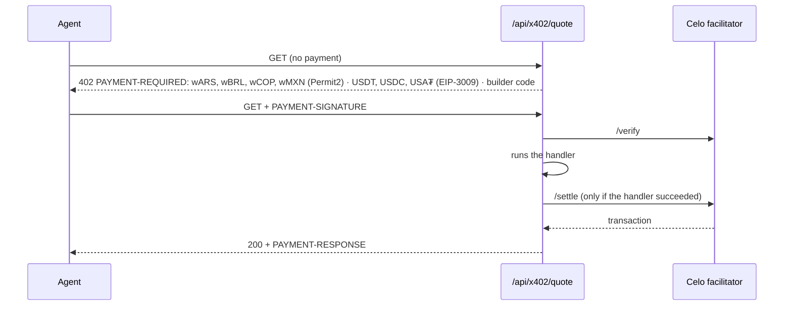

# Arbolito architecture

How Arbolito is built, as deployed on Celo mainnet (November 2026). It covers what runs where, which wallet signs what, how each money flow works step by step, and what keeps it safe. Addresses and endpoints are verified in [04-reference.md](04-reference.md). The desk's pricing strategy is in [DESK-STRATEGY.md](DESK-STRATEGY.md).

## Contents
1. [System context](#1-system-context)
2. [Components](#2-components)
3. [Wallets and keys](#3-wallets-and-keys)
4. [Flows](#4-flows)
   - [4.1 A conversion in MiniPay](#41-a-conversion-in-minipay)
   - [4.2 A send to a contact](#42-a-send-to-a-contact)
   - [4.3 Automatic rules and the peso guardian](#43-automatic-rules-and-the-peso-guardian)
   - [4.4 Another agent pays Arbolito (x402)](#44-another-agent-pays-arbolito-x402)
   - [4.5 Arbolito pays another agent and rates it](#45-arbolito-pays-another-agent-and-rates-it)
   - [4.6 Arbolito Desk](#46-arbolito-desk)
   - [4.7 Western Union, read through buy](#47-western-union-read-through-buy)
   - [4.8 A user rates Arbolito](#48-a-user-rates-arbolito)
5. [ProofBundle and receipts](#5-proofbundle-and-receipts)
6. [Safety model](#6-safety-model)
7. [Data model](#7-data-model)
8. [Testing](#8-testing)

---

## 1. System context

The **user's own wallet** (MiniPay) signs every conversion and send. The only thing Arbolito signs for a user is a run of a rule the user turned on, and only through ArbolitoGuard, within the limits the user set onchain.

## 2. Components

| Component | Path | Runs on | What it does |
|---|---|---|---|
| Web app | `apps/web` | Vercel (Next.js 16) | Landing; the MiniPay Mini App and its API (`/api/miniapp/*`: quote, prepare, submit, receipts, send, autonomy, rules, chat, rate); public receipts `/r/<id>` (verified in the browser); `/metrics`, `/desk`, `/agent`; the x402 API (`/api/x402/quote`, `/api/x402/rates`); MCP (`/api/mcp`), A2A (`/api/a2a`, card at `/.well-known/agent-card.json`), OASF and the ERC-8004 file (`/.well-known/*`) |
| Bot | `apps/agent` | Railway `arbolito-bot` (`Dockerfile.bot`) | Telegram (grammY) with the same chat agent; links a Telegram chat to a MiniPay wallet; runs the **rules runner** (every 60 s), the **Western Union runner** (every 6 h, through buy) and **agent purchases** (every 12 h) |
| Desk | `apps/desk` | Railway `desk-feed` (`Dockerfile.desk-feed`) | The Textile FX maker: multi-source fair value, inventory skew, carry-aware targets, breaker, risk officer (LLM, pause-only), rebalancer; supervises Textile's own filler (Stitch), which signs quotes from this feed; ledger and public `/state` |
| Router | `packages/router` | (library) | Uniswap v3 and Textile RFQ adapters, the route planner (best of all venues and two-leg routes), executor, reference rates (official/MEP/CCL/crypto ARS, BRL, COP, MXN, venue mids) |
| Proof | `packages/proof` | (library) | ProofBundle schema, canonical JSON, keccak256, anchoring, verification |
| Rules | `packages/rules` | (library) | Rule kinds (`send`, `split`, `guardian`), the text a user signs, schedules, the guardian's decision logic, the runner |
| Chain | `packages/chain` | (library) | Clients, the **guarded sender** (simulate, tag, cap, never retry), ArbolitoGuard v2 encoders and reads, ERC-8004 Reputation encoder |
| x402 | `packages/x402` | (library) | v1 client (pays buy), v2 client (pays other agents), **seller** (Arbolito's paid API) on the official `@x402/*` SDK |
| Competitors | `packages/competitors` | (library) | Drives a browser rented through buy to read Western Union's converter |
| LLM | `packages/llm` | (library) | The chat agent (DeepSeek, OpenAI-compatible): tool schemas, prompts, the tool loop. No tool moves money |
| DB | `packages/db` | Neon | Drizzle schema and queries ([§7](#7-data-model)) |
| Config | `packages/config` | (library) | Verified addresses, tokens, pools, the env schema (`.env.example` is kept in sync by a test) |
| Contracts | `contracts/` | Celo | `ArbolitoReceipts` (receipt anchors), `ArbolitoGuard` v2 (bounded autonomy). Foundry |

## 3. Wallets and keys

| Wallet | Address | Key lives | May do |
|---|---|---|---|
| **The user's MiniPay wallet** | (theirs) | MiniPay | Everything for itself: sign conversions, sends, guard setup, rules, ratings |
| **Agent / ops** (ERC-8004 #9976 owner) | `0x7e03…6c3c` | `.env` locally; on Railway as `BUY_PAYER_PRIVATE_KEY` | Owns the identity and contracts; receives x402 payments (`payTo`); pays buy and outside agents; rates outside agents |
| **Rules operator** | `0xeA71…36b4` | Railway (`ARBOLITO_OPERATOR_PRIVATE_KEY`) | Only `swapFor`/`sendFor` on ArbolitoGuard, for accounts that named it operator, within their limits. Holds gas only |
| **Anchor** | `0x89dC…7CA4` | Vercel (`ANCHOR_PRIVATE_KEY`) | Only anchors receipt hashes on ArbolitoReceipts. Holds gas only |
| **Desk maker** | `0xBCB8…EdbE` | Railway (`DESK_PRIVATE_KEY`) | The Textile maker's inventory (capped in config), Permit2 approvals to the reactor, rebalancer swaps |
| e2e / reserve | (local) | local `.env` only | Tests on mainnet with tiny amounts; the reserve holds float off the servers |

Every transaction any of these sends carries the ERC-8021 attribution suffix for `celo_e054d92430a5`. User transactions carry it because the server builds their calldata (`withAttribution`), and MiniPay keeps it intact.

## 4. Flows

### 4.1 A conversion in MiniPay

- Wallets: the user's (swap), the anchor wallet (anchor).
- Guarantees:
  - A firm quote past its deadline is refused before signing.
  - A firm Textile quote below the guaranteed minimum is cancelled before the user signs (`price_changed`).
  - The receipt records exactly what arrived (`receivedInTx`), never the quoted amount.

### 4.2 A send to a contact

The same flow as 4.1, with a recipient.
- **Same currency:** one transfer.
- **Cross currency:** the Uniswap swap pays the contact directly, or a Textile fill settles to the user and an exact forward follows.

The receipt names the recipient.

### 4.3 Automatic rules and the peso guardian

**Setup (once):** in MiniPay, the user signs these transactions on ArbolitoGuard v2:
- bounded ERC-20 approvals to the guard
- `configure`: per-token limits per operation and per day, allowed contacts, max slippage
- `setOperator` (Arbolito's operator, with an expiry)

The guard is ownerless and pins the swap router, the pools and a 10-minute TWAP floor.

**A rule:** the chat drafts it. The user turns it on by signing its exact text (`personal_sign`), which names the account and the rule id.

| Kind | Trigger | Moves |
|---|---|---|
| `send` | Monthly on a day (13:00 UTC) | USDT (or swapped to wARS/wBRL/…) to an allowed contact |
| `split` | An incoming USDT payment from someone else | `percent` of it into another currency |
| `guardian` | Hourly evaluation | `sym` ⇄ USDT to keep the savings near a target dollar share |

**The peso guardian's decision** (`packages/rules`, pure and unit-tested):
- target dollar share = `baseDollarPct` + 2 points per bps/day of depreciation, clamped to ±20 points and to 0–100
- the depreciation is Arbolito Desk's **measured carry**: a Theil–Sen slope over daily medians of the last week
- if the share is below `target − band`, it sells `sym` for USDT (protect); above `target + band`, it buys `sym` back (re-enter)
- it stands down while the desk's breaker holds the currency, and when the savings or the move are tiny

- An unconfirmed broadcast stops the rule until a human checks it.
- A failure before broadcast skips the run.
- Nothing is retried.
- "Pause Arbolito" is a single signature, with no transaction, and the runner honours it right away.

### 4.4 Another agent pays Arbolito (x402)

- Prices are in US$: US$ 0.01 for a quote, US$ 0.005 for the rates bundle.
- wFIAT prices are converted at the desk's fair value and rounded up to two significant figures. That way the price holds between the 402 and the payment.
- wFIAT is paid gaslessly with Permit2 and an EIP-2612 permit (the facilitator's `eip2612GasSponsoring`).
- `payTo` is the agent wallet. Each sale is recorded in `x402_sales`.
- x402 v1 (`X-PAYMENT`) gets an explicit 402 saying v2 is required.
- MCP's `get_quote`/`get_rates` and A2A's `quote`/`rates` skills lead to the same endpoints.

### 4.5 Arbolito pays another agent and rates it

The bot's agent-purchases runner (off unless `AGENT_BUYS=live`) runs these steps:
1. Reads the provider's free 402.
2. Checks the price against the provider's maximum and the lifetime budget, counted from `agent_purchases`.
3. Pays with the v2 client from the agent wallet, and records the row.
4. Sends a tagged `giveFeedback` to the provider's ERC-8004 identity: 100 if it answered with data, 20 if it took the payment without.

An unclear payment stops the runner.

### 4.6 Arbolito Desk

The feed (`apps/desk`) prices wARS, wBRL, wCOP, wMXN, USDC and USA₮ against USDT. It works from several sources at once: Textile mids, Uniswap, dolarapi, ER-API and the ECB. It adds an inventory skew, carry-aware targets and dispersion-scaled caps. Textile's Stitch signs firm, exclusive RFQ quotes from that price.

Supporting parts:
- **Risk officer:** an LLM that can only pause a corridor.
- **Rebalancer:** sells inventory above the cap back to USDT, in small slices with a price floor.
- **Ledger:** fills, snapshots and the feed's decisions, shown on `/desk` and at `/state`.

Full reasoning is in [DESK-STRATEGY.md](DESK-STRATEGY.md).

### 4.7 Western Union, read through buy

Every 6 hours the bot pays buy's x402 v1 gateway for a 2-minute browser (about US$ 0.004 in USDT). It reads Western Union's own converter for USD→BRL and USD→ARS and drops any reading implausible against Arbolito's references. It stores each reading with its payment tx.

Quotes and receipts then show "vs Western Union", citing that payment.

### 4.8 A user rates Arbolito

On a verified receipt the Mini App offers 1–5 stars. The server checks that the wallet asking is the receipt's taker. It returns one tagged call: `giveFeedback(9976, stars × 20, "conversion", "<from>-<to>", …, feedbackURI = /r/<id>, feedbackHash = keccak256(uri))`.

The user signs it in MiniPay. The registry itself refuses self-feedback from the owner.

## 5. ProofBundle and receipts

Every conversion produces a **ProofBundle** (`packages/proof`) holding:
- the request
- every venue quote considered, with block numbers
- the chosen route
- the execution tx and the exact amount delivered
- the reference rates, Western Union included (citing its buy payment)
- the savings against them

The bundle is canonical JSON. Its keccak256 is anchored with `ArbolitoReceipts.emitReceipt(bundleHash, routeId)` from an allowed emitter (event `ReceiptAnchored`).

`/r/<id>` recomputes the hash **in the browser** and checks, against Celo mainnet:
- the anchor event (hash, routeId, emitter)
- that the execution tx succeeded at the stated block
- that it carries the attribution code
- that it delivered exactly `amountOut`

A tampered bundle or a foreign emitter fails. A superseded bundle stays listed, marked, and is never counted.

## 6. Safety model

- **The user signs.** Conversions and sends are signed in the user's own MiniPay wallet. The chat agent has no tool that moves money.
- **Bounded autonomy.** Rule runs go only through ArbolitoGuard v2, which enforces onchain:
  - the account's per-token, per-operation and daily limits
  - its allowed contacts
  - a TWAP price floor
  - pinned pools and router
  - an operator that expires and can be revoked

  Arbolito adds no cap of its own on a user's rules; the user's signed limits are the limits.
- **Every send is guarded** (`sendGuarded`):
  - simulated first
  - ERC-8021-tagged
  - checked against per-action and daily caps (spend ledger in Postgres, per signer)
  - fees capped
- **Never retry a paid call.** A timeout or unclear answer after paying keeps the reservation and stops the runner. Applies to x402 v1 and v2, buy, and agent purchases.
- **Quote before paying.** Every x402 purchase reads the free 402 first and refuses prices above a fixed maximum. x402 sales settle only after the handler succeeded.
- **Fork first.** New money paths run on an anvil fork of Celo mainnet before any mainnet send: the guard, the runner (including the guardian), and the Textile reactor with a smart account.
- **Secrets.** Keys live only in `.env` and the hosts' secret stores. Logs redact claim tokens and poll URLs.

## 7. Data model

Neon Postgres, Drizzle (`packages/db/src/schema.ts`), migrations `0000`–`0009`. Money columns are `numeric(78,0)` in atomic units.

| Area | Tables |
|---|---|
| Users and chat | `users`, `contacts`, `messages`, `link_codes`, `pending_actions` |
| Conversions | `miniapp_quotes` (quotes and prepared calls), `receipts` (bundles, anchors, taker) |
| Spend | `spend_ledger` (caps per signer) |
| Rules | `rules` (kind, params, signed text, status), `rule_runs` (unique per rule and trigger), `autonomy_pauses` |
| Desk | `desk_fills`, `desk_snapshots`, `desk_rfqs`, `desk_state` |
| buy | `competitor_rates` (Western Union readings and their payments) |
| x402 | `x402_sales` (what other agents paid Arbolito), `agent_purchases` (what Arbolito paid other agents, with the rating tx) |

## 8. Testing

| Suite | Command | Proves |
|---|---|---|
| Unit | `pnpm test` | Routing, pricing, ProofBundle hashing and verification, the Mini App API with fake chains and venues, rules and the guardian's decisions, the x402 seller and v2 client, the desk's feed, risk and rebalancer logic. Runs offline |
| Contracts | `pnpm contracts:test` (in `pnpm test`) | ArbolitoGuard and ArbolitoReceipts in Foundry |
| Fork | `pnpm test:fork` | Against Celo mainnet state on anvil: wBRL→wARS executed and its receipt anchored and verified; the rules runner (sends, splits, pieces and limits, revocation) and the peso guardian (both directions, breaker hold) through the **deployed** guard |
| DB | `pnpm test:db` | Queries against a real Postgres |
| Live, free | `pnpm x402:check <url> <token> [--e2e]` | Celo's facilitator verifies a payment for our 402 without settling it |
